<div align="center">
  

  **简体中文** · [English](./README_EN.md)

  # 小红书运营自动化工坊

  **把散落的业务素材，变成有依据、可审核、可持续复用的小红书内容资产。**

  一款本地优先的桌面工作台，覆盖素材沉淀、事实核对、选题策略、文案修订、双路线配图与终稿避重。

  [](./package.json)
  [](https://nodejs.org/)
  [](https://www.electronjs.org/)
  [](./.github/workflows/build-windows.yml)
  

  [产品理念](#产品理念) · [素材管理](#一先把素材变成资产) · [生成流程](#二再用一条可回溯的流程完成创作) · [快速开始](#快速开始) · [开发说明](#开发说明)
</div>

<br />

<div align="center">
  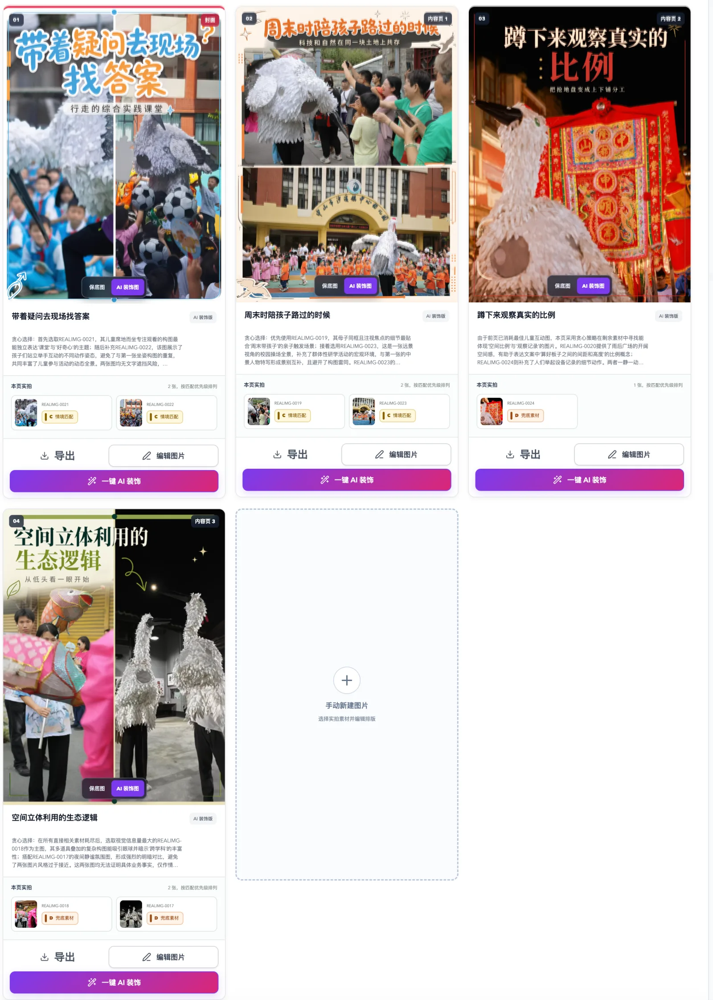
  <br />
  <sub>实拍图一键策划生成：系统围绕已确认文案自动选图、分组和排版，并保留手动编辑与 AI 装饰入口。</sub>
</div>

## 产品理念

通用 AI 对话擅长“写一篇”，却很难管理长期内容生产：业务资料散落、事实口径互相冲突、参考内容不可追溯，生成过的选题下一轮还会重复。

小红书运营自动化工坊把一次性对话变成一个持续积累的本地项目：

| 从 | 到 |
| --- | --- |
| 把所有资料一次性塞进提示词 | 将业务事实、关键词、参考文案、合规规则和图片分层管理 |
| 直接让模型开始写 | 先提取事实、处理冲突，再进入选题和创作 |
| 一篇笔记承担所有卖点 | 用微选题拆出多个清晰、互不重复的内容方向 |
| 文案与配图各自为战 | 让配图只服务于已经确认的文案与策略 |
| 生成完成就散落在聊天记录里 | 将终稿、版本、图片和策略统一入库，参与后续避重 |

> [!NOTE]
> “生活化种草”指更原生、更有独立内容价值的表达方式，不代表伪装普通用户或规避商业标识。产品仍要求内容以已确认事实为边界，并支持维护项目自己的合规准则。

## 一、先把素材变成资产

每个项目都拥有独立素材库。生成时只读取当前启用的内容，关闭“生效”即可暂时排除某条资产，无需删除。

> 下方产品截图统一采用双栏尺寸；点击任意截图可查看清晰原图。

| 资产 | 在生成中的作用 |
| --- | --- |
| **业务原始素材** | 作为事实来源，可直接导入 Markdown，也可从 PDF 或图片中提取。 |
| **关键词** | 管理核心词、长尾词、意图标签与建议槽位，帮助模型自然组织搜索表达。 |
| **参考文案** | 沉淀高表现内容的标题、正文和话题标签，提供结构与表达参考。 |
| **合规准则** | 维护禁用表达、风险类型、判定依据、处理方式与替代写法。 |
| **小红书图片** | 保存封面和内容页样本；自动提取视觉标签，供 AI 套图匹配参考。 |
| **业务实拍** | 客观分析现场照片的画面内容，生成宣传图时再按当前文案选图。 |

### 文案资产：可维护、可迁移

关键词、参考文案和合规准则均支持手动编辑、Excel 模板批量导入以及完整导出。

<table>
  <tr>
    <td width="50%">
      <a href="./docs/readme/assets-keywords.webp">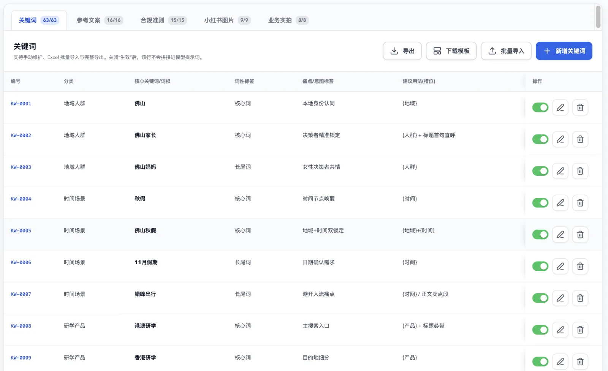</a>
      <p align="center"><b>关键词库</b><br /><sub>维护分类、词性、用户意图与建议用法</sub></p>
    </td>
    <td width="50%">
      <a href="./docs/readme/assets-copy-references.webp">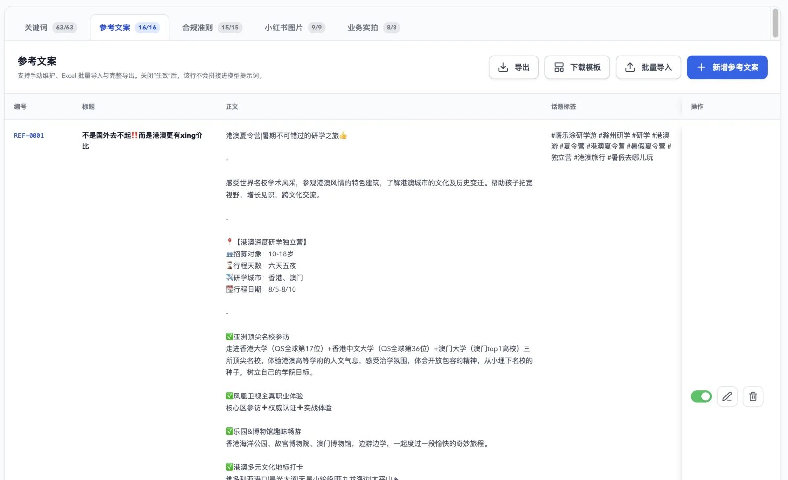</a>
      <p align="center"><b>参考文案库</b><br /><sub>沉淀标题、正文和话题标签，支持按需启用</sub></p>
    </td>
  </tr>
  <tr>
    <td width="50%">
      <a href="./docs/readme/assets-compliance.webp">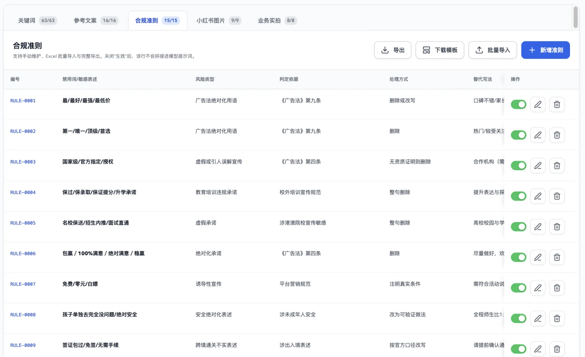</a>
      <p align="center"><b>合规准则库</b><br /><sub>明确风险类型、判定依据、处理方式与替代表达</sub></p>
    </td>
    <td width="50%" valign="top">
      <p><b>统一的资产管理方式</b></p>
      <ul>
        <li>单条新增或编辑</li>
        <li>Excel 模板批量导入</li>
        <li>完整导出与跨项目迁移</li>
        <li>通过“生效”开关控制本轮是否读取</li>
      </ul>
    </td>
  </tr>
</table>

### 图片资产：参考样本与真实现场分开管理

<table>
  <tr>
    <td width="50%">
      <a href="./docs/readme/assets-image-references.webp">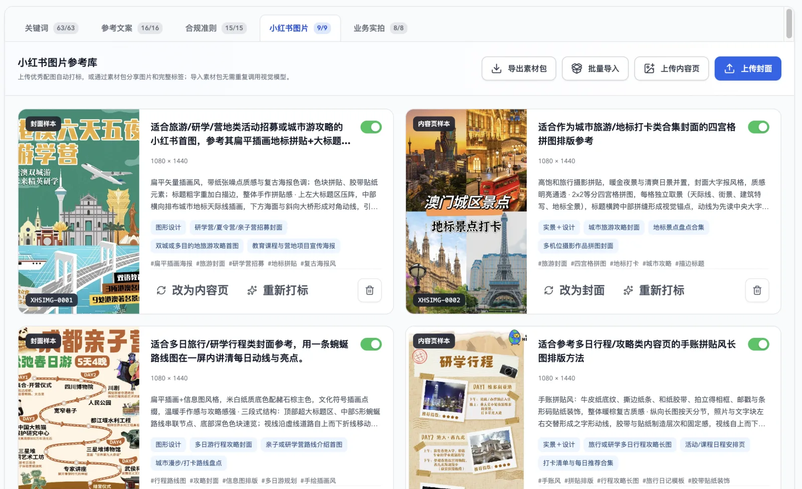</a>
      <p align="center"><b>小红书图片参考库</b><br /><sub>学习优秀样本的构图、版式、风格与使用场景</sub></p>
    </td>
    <td width="50%">
      <a href="./docs/readme/assets-real-photos.webp">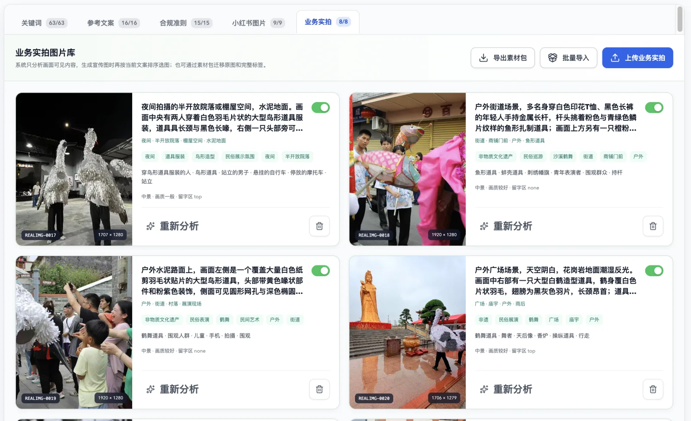</a>
      <p align="center"><b>业务实拍图片库</b><br /><sub>只分析画面可见内容，按文案相关性排序选图</sub></p>
    </td>
  </tr>
</table>

两类图库互不混用：参考图库服务于 AI 图生图，业务实拍图库服务于真实照片排版。它们都支持带原图与完整标签的素材包导入、导出，方便在项目之间迁移。

## 二、再用一条可回溯的流程完成创作

```text
准备素材 → 核对事实 → 选择内容模式 → 选择微选题策略
        → 生成文案 → 审核确认 → 制作配图 → 确认入库
```

流程中的策略、文案修订、配图版本和最终结果都会保留；返回历史生成时，仍可查看当时采用的依据。

### 1. 确认素材，再核对业务事实

开始创作前，系统先检查业务原始素材和当前生效的内容资产。模型只提取素材实际包含的事实；遇到价格、日期、服务范围等冲突口径时，会集中列出并等待人工确认。

<table>
  <tr>
    <td width="50%"><a href="./docs/readme/workflow-01-materials.webp">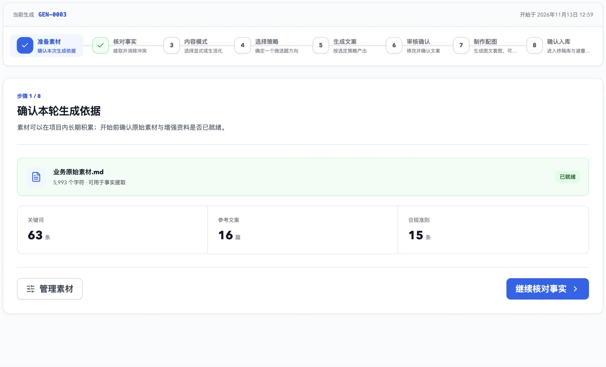</a></td>
    <td width="50%"><a href="./docs/readme/workflow-02-fact-check.webp">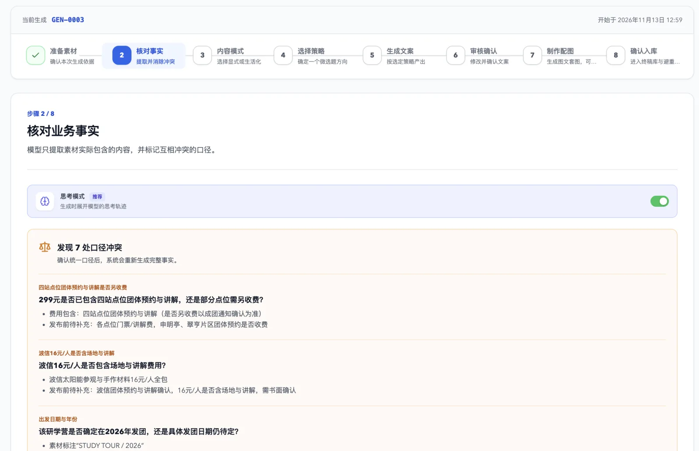</a></td>
  </tr>
  <tr>
    <td align="center"><b>准备素材</b><br /><sub>确认这轮生成实际读取的资产</sub></td>
    <td align="center"><b>核对事实</b><br /><sub>先统一冲突口径，再继续创作</sub></td>
  </tr>
</table>

事实整理与冲突识别会实时展示进度；开启“思考模式”时，也可以查看模型返回的推理文本。

<table>
  <tr>
    <td width="50%">
      <a href="./docs/readme/workflow-03-mode.webp">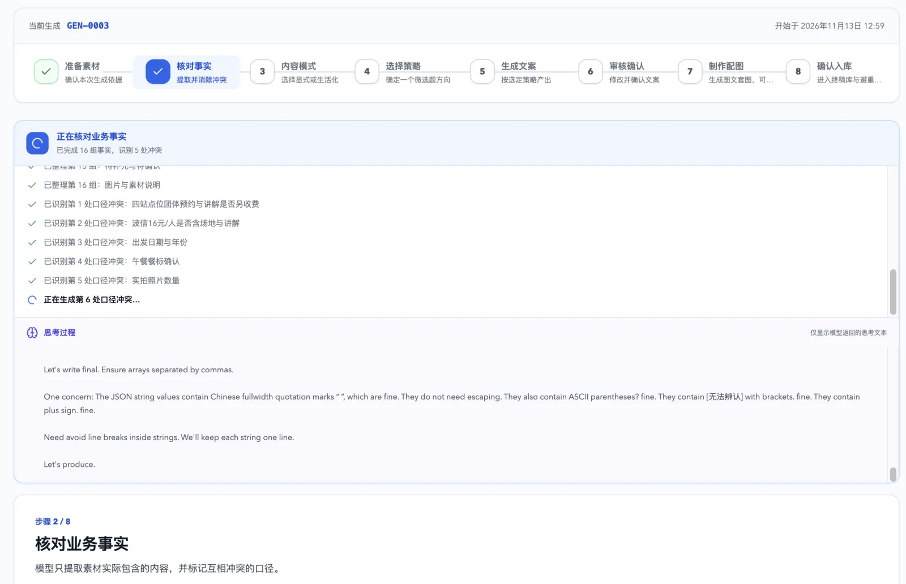</a>
      <p align="center"><b>过程可见</b><br /><sub>逐项反馈事实整理与冲突识别进度</sub></p>
    </td>
    <td width="50%" valign="top">
      <p><b>不是黑盒等待</b></p>
      <p>界面会持续显示已经整理的事实、已经发现的冲突和当前执行阶段；开启“思考模式”后，还可展开查看模型返回内容。</p>
    </td>
  </tr>
</table>

### 2. 选择表达模式与微选题

同一份业务资料可以选择两种不同的内容契约：

| 内容模式 | 适合什么内容 | 默认约束 |
| --- | --- | --- |
| **显式宣传** | 产品介绍、活动招募、服务说明与转化内容 | 可以承载更多业务信息，但仍保持单一主线。 |
| **生活化种草** | 场景经验、问题解法、知识内容与轻量业务承接 | 聚焦一个具体问题，先提供独立价值，再自然连接 1–2 个业务点。 |

系统会围绕已确认事实生成 3–5 个微选题，并明确写给谁、解决什么问题、如何承接业务，以及与历史终稿有何不同。可一次选择多个策略，分别生成多篇文案。

<table>
  <tr>
    <td width="50%">
      <a href="./docs/readme/workflow-04-strategy.webp">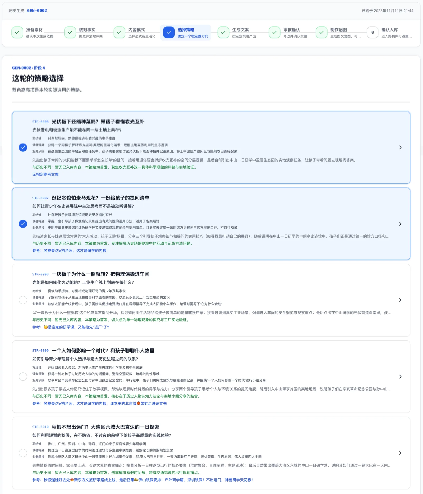</a>
      <p align="center"><b>微选题策略</b><br /><sub>比较受众、问题、写作角度、业务承接与历史差异</sub></p>
    </td>
    <td width="50%" valign="top">
      <p><b>一轮可以选择多个方向</b></p>
      <ul>
        <li>从完整业务中拆出单一、清晰的小切口</li>
        <li>显示每个策略与历史内容的差异</li>
        <li>为每个选中策略分别追加最高优先级要求</li>
        <li>一次生成多篇互不相同的文案</li>
      </ul>
    </td>
  </tr>
</table>

### 3. 生成文案，保留每一次修订

每篇文案都可以直接编辑，也可以用自然语言提出修改要求。AI 修订会生成新版本而不是覆盖旧稿；如果要求改变了人群、角度或卖点，策略快照也会同步更新。

<table>
  <tr>
    <td width="50%">
      <a href="./docs/readme/workflow-05-copy-review.webp">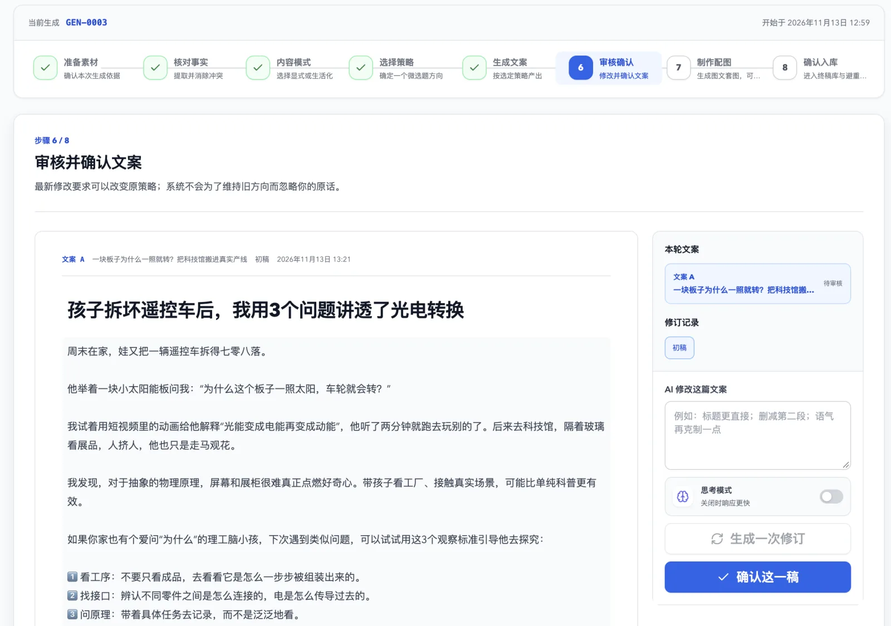</a>
      <p align="center"><b>文案审核与修订</b><br /><sub>直接编辑，或用自然语言生成新版本</sub></p>
    </td>
    <td width="50%" valign="top">
      <p><b>保留每一次有效修改</b></p>
      <ul>
        <li>多篇文案独立审核</li>
        <li>初稿和修订稿随时切换</li>
        <li>新版本不会覆盖旧稿</li>
        <li>确认后的版本才进入配图环节</li>
      </ul>
    </td>
  </tr>
</table>

### 4. 用两条路线完成配图

确认文案后，可任选一种方式制作 3:4 小红书配图，也可以暂时跳过。

<table>
  <tr>
    <td width="50%">
      <a href="./docs/readme/workflow-06-ai-images.webp">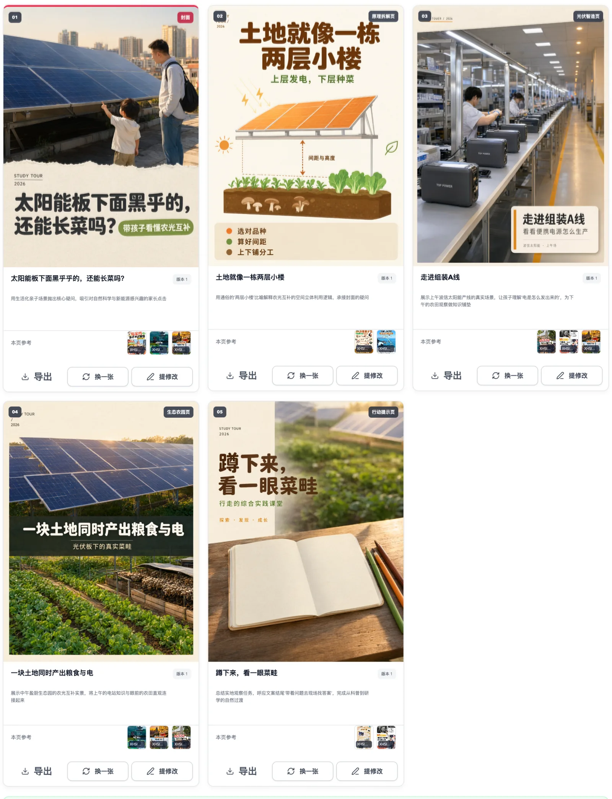</a>
      <p align="center"><b>AI 生成套图</b><br /><sub>拆解翻页节奏，为每页匹配参考样本并生成新画面</sub></p>
    </td>
    <td width="50%">
      <a href="./docs/readme/workflow-06-real-photo-images.webp"></a>
      <p align="center"><b>实拍宣传图</b><br /><sub>按当前文案智能选图、分组与排版，保留真实业务画面</sub></p>
    </td>
  </tr>
</table>

AI 套图支持逐页导出、换图和按反馈重生成。实拍宣传图同时保留“保底排版”和“AI 装饰”两个版本，还可以手动选择 1–4 张照片、切换版式、调整标题和强调色。

<table>
  <tr>
    <td width="50%">
      <a href="./docs/readme/workflow-06-real-photo-editor.webp">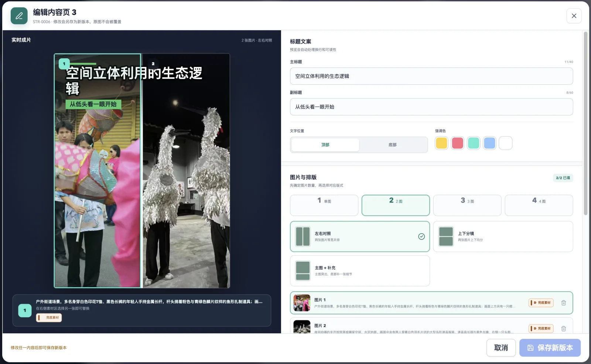</a>
      <p align="center"><b>实拍图排版编辑器</b><br /><sub>手动换图、切换模板并调整标题与强调色</sub></p>
    </td>
    <td width="50%" valign="top">
      <p><b>自动生成后仍然可控</b></p>
      <ul>
        <li>每页选择 1–4 张业务实拍</li>
        <li>支持单图、对照、分镜等排版</li>
        <li>修改内容会保存为新版本</li>
        <li>可在保底图与 AI 装饰图之间切换</li>
      </ul>
    </td>
  </tr>
</table>

### 5. 确认入库，让下一轮自动避重

“确认文案”只表示该版本可以继续配图；“确认入库”才代表它成为正式内容资产。入库后，核心选题、目标人群、切入问题和业务承接方式会进入同模式的避重范围，图片只作为资产保存，不参与重复判断。

<table>
  <tr>
    <td width="50%">
      <a href="./docs/readme/workflow-07-archive.webp">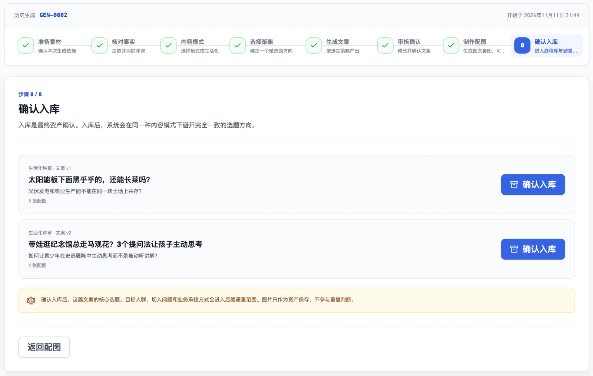</a>
      <p align="center"><b>确认入库</b><br /><sub>选择最终文案与配图，沉淀为可复用内容资产</sub></p>
    </td>
    <td width="50%" valign="top">
      <p><b>入库才进入避重范围</b></p>
      <ul>
        <li>保存最终文字和选定图片</li>
        <li>记录内容模式与策略快照</li>
        <li>显式宣传与生活化种草分池避重</li>
        <li>图片作为资产保存，不参与重复判断</li>
      </ul>
    </td>
  </tr>
</table>

## 核心能力

| 能力 | 说明 |
| --- | --- |
| 事实驱动 | 从 Markdown、PDF 或图片中提取业务事实，发现冲突后由人工统一口径。 |
| 项目级资产库 | 关键词、参考文案、合规准则和两类图片素材长期积累、按需启用。 |
| 双内容模式 | 显式宣传与生活化种草使用不同的内容约束，并分池进行终稿避重。 |
| 微选题生产 | 从完整业务中拆出可持续生产的小切口，一轮可并行选择多个方向。 |
| 人机协同审稿 | 支持直接编辑、自然语言修订、版本保留与策略快照更新。 |
| 双路线配图 | 既能参考优秀样本生成新套图，也能用业务实拍完成可编辑宣传图。 |
| 本地优先 | 项目资产以 JSON、Markdown 和图片文件保存在用户选择的文件夹中。 |

## 快速开始

### 环境要求

- Node.js 22 或更高版本
- npm
- macOS、Windows 或 Linux

### 本地运行

```bash
git clone https://github.com/qfzhao670/xhs-ads-agent.git
cd xhs-ads-agent
npm ci
npm run dev
```

首次启动后：

1. 在“设置”中填写模型接口地址、API Key、文案模型和视觉理解模型。
2. 选择一个空文件夹创建项目，或打开已有项目文件夹。
3. 导入业务原始素材，并在素材管理中补充需要长期复用的内容资产。
4. 前往“文案生成”，按页面上的 8 个步骤完成第一轮内容生产。

> [!IMPORTANT]
> 项目文件和 API Key 保存在本机；调用文案、OCR、视觉理解或图片模型时，当次任务需要的文本或图片会发送给你配置的模型服务商。请根据数据敏感级别选择合适的接口。

### 模型配置

| 用途 | 要求 |
| --- | --- |
| 文案生成与修订 | Chat Completions 兼容接口；模型需能稳定返回结构化 JSON。 |
| PDF / 图片素材提取 | 支持图片理解的视觉模型；PDF 还需接口支持文件输入。 |
| 两类图片自动打标 | 支持图片输入的视觉理解模型。 |
| AI 套图与实拍 AI 装饰（可选） | 支持图生图的图片模型；内置 DashScope Qwen Image 与 OpenAI 兼容协议配置。 |

## 本地项目结构

每个业务项目都是一个普通文件夹，不依赖远程数据库：

```text
你的项目/
├── 小红书运营工坊.json
├── 业务原始素材.md
├── 项目数据/
│   ├── 关键词库.json
│   ├── 高表现参考文案库.json
│   ├── 合规性准则.json
│   ├── 小红书图片参考库.json
│   ├── 小红书图片参考库/
│   ├── 业务实拍图库.json
│   ├── 业务实拍图库/
│   └── 终稿内容库.json
└── 生成结果/
    ├── 业务事实.md
    ├── 配图记录.json
    └── 文案、策略、图片与历史版本…
```

项目文件可以正常备份、同步，或加入你自己的版本管理流程。

## 开发说明

### 常用命令

| 命令 | 用途 |
| --- | --- |
| `npm run dev` | 同时启动 Vite 与 Electron 开发环境。 |
| `npm run check` | 执行 TypeScript 检查并构建前端。 |
| `npm test` | 运行 Electron 主进程的 Node.js 单元测试。 |
| `npm run package` | 构建当前平台未封装的应用目录。 |
| `npm run dist` | 构建当前平台安装包。 |
| `npm run dist:win` | 构建 Windows x64 NSIS 安装包。 |

### 技术栈

- React + TypeScript + Vite
- Electron + context-isolated preload bridge
- 本地 JSON、Markdown 与图片文件
- OpenAI 兼容的文案及视觉模型接口
- DashScope / OpenAI 兼容的图片生成接口

Windows 安装包可通过 GitHub Actions 手动构建，也可在推送 `v*` 标签时自动发布到 GitHub Releases。完整步骤见 [命令行打包说明](./docs/命令行打包说明.md)。

## 常见问题

<details>
<summary><b>为什么必须先核对事实？</b></summary>
<br />

同一批资料中经常同时存在旧价格、新价格、不同活动日期或不同服务范围。先确认口径，可以避免模型把互相冲突的信息拼进同一篇内容。

</details>

<details>
<summary><b>为什么 AI 套图按钮不可用？</b></summary>
<br />

AI 套图需要至少一张已完成视觉打标的样本。请先到“素材管理 → 小红书图片”上传封面或内容页参考图。

</details>

<details>
<summary><b>为什么实拍宣传图按钮不可用？</b></summary>
<br />

请先到“素材管理 → 业务实拍”上传真实照片，并等待客观画面分析完成。实拍素材不会被当作 AI 参考图使用。

</details>

<details>
<summary><b>图片生成中断后需要全部重来吗？</b></summary>
<br />

不需要。套图任务会保留已完成页面，再次继续时从未完成的位置恢复。

</details>
