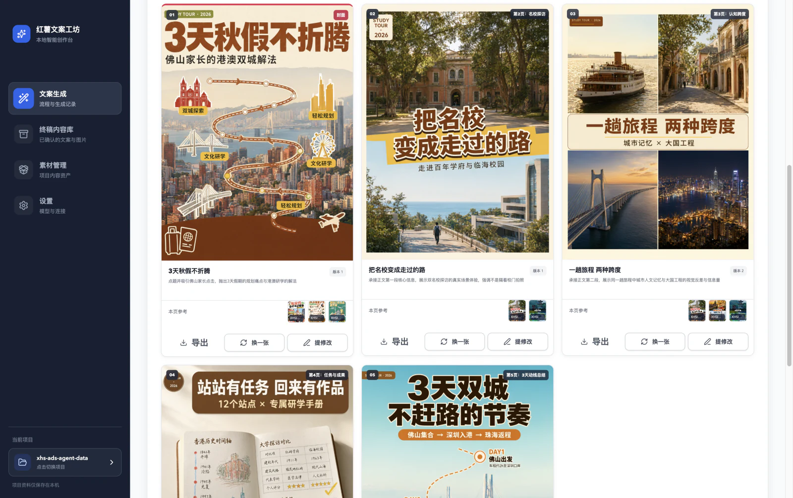
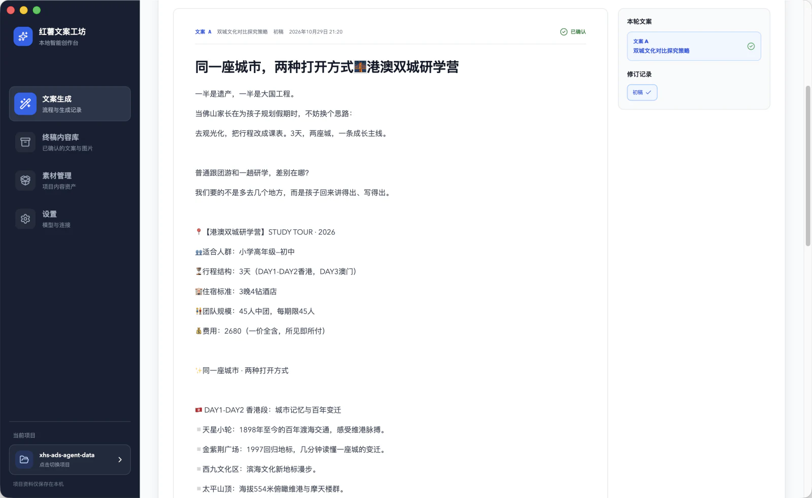
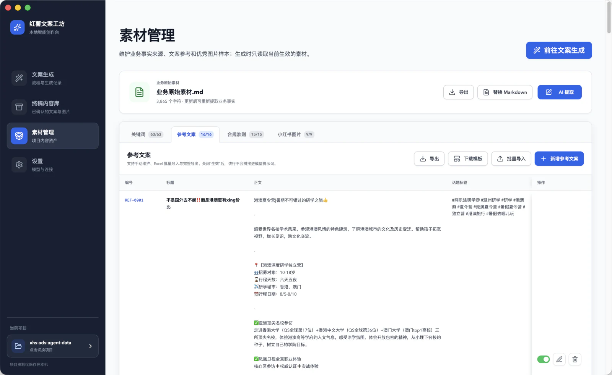
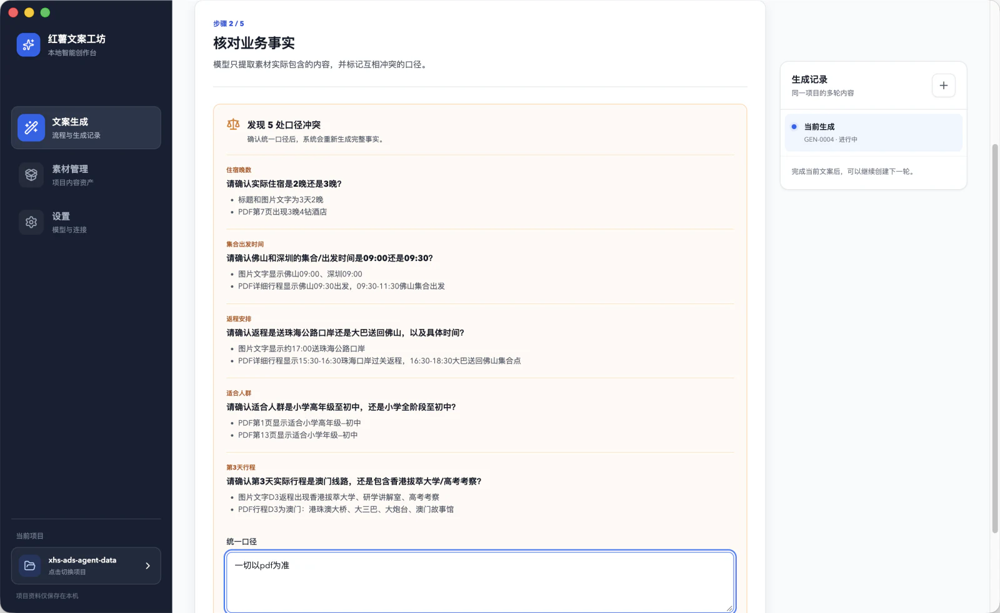
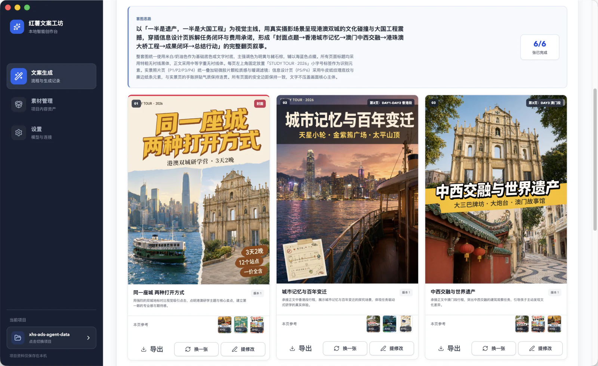

<div align="center">
  

  [简体中文](./README.md) | **English**

  # Rednote Copy Workshop

  **A local-first, fact-driven desktop workspace for producing RedNote content**

  Manage the complete content workflow—from source materials, fact verification, and micro-topic strategy to copy review, image generation, and final archiving—with a traceable process.

  [](./package.json)
  [](https://nodejs.org/)
  [](https://www.electronjs.org/)
  [](./.github/workflows/build-windows.yml)
  

  [Highlights](#highlights) • [Product Tour](#product-tour) • [Quick Start](#quick-start) • [Workflow](#workflow) • [Development](#development-and-packaging)
</div>

<br />

<div align="center">
  
  <br />
  <sub>Captured from the running desktop application. The interface has not been redrawn with AI.</sub>
</div>

## Why this tool exists

General-purpose AI chat can easily turn “write a RedNote post” into a one-off conversation: source materials are scattered, facts conflict, references cannot be traced, and every new post starts from scratch.

Rednote Copy Workshop turns content production into a reusable local project:

- Extract and confirm business facts from source materials before writing.
- Keep keywords, reference posts, compliance rules, and image samples inside the project for long-term reuse.
- Preserve strategies, revisions, images, and final drafts without overwriting earlier generations.
- Maintain separate archives for explicit promotion and native lifestyle content, with automatic topic deduplication within each mode.

## Highlights

| Capability | Description |
| --- | --- |
| Facts first | Extract business facts from Markdown, PDFs, or images; flag conflicting claims and resolve them before writing. |
| Two content contracts | Use **explicit promotion** to explain an offering clearly, or **native lifestyle content** to solve one concrete reader problem before introducing the business naturally. |
| Micro-topic strategies | Generate 3–5 focused angles at a time, select multiple strategies, and add high-priority instructions to each post. |
| Human-in-the-loop review | Edit directly on the canvas or request a revision in natural language; every version is retained. |
| Reusable content assets | Maintain keywords, compliance rules, and high-performing reference posts manually or through Excel import and export. |
| Reference-driven visuals | Tag strong visual samples, select references for every page, and generate traceable 3:4 RedNote image sets with version history. |
| Local project storage | Keep business materials, JSON assets, Markdown drafts, and images in a folder you control. |

## Product tour

<table>
  <tr>
    <td width="50%">
      
      <p align="center"><b>Copy review</b><br /><sub>Manual editing, AI revisions, multiple drafts, and version confirmation</sub></p>
    </td>
    <td width="50%">
      
      <p align="center"><b>Asset management</b><br /><sub>Source materials, keywords, reference posts, and compliance rules</sub></p>
    </td>
  </tr>
</table>

### Resolve conflicting facts before writing

The model gathers conflicting claims from the source materials in one place. It rebuilds the final fact set only after a human confirms standards such as accommodation, schedules, pricing, or target audience.



### Generate a complete image set from approved copy

The image workspace plans 4–6 vertical 3:4 pages and matches reference samples to the cover and each content page. Every page can be exported, regenerated, or revised with targeted feedback.



> [!NOTE]
> All images above are real product screenshots. They were only cropped, resized, and compressed as WebP files.

## Quick start

### Requirements

- Node.js 22 or later
- npm
- macOS, Windows, or Linux

### Run locally

```bash
git clone https://github.com/qfzhao670/xhs-ads-agent.git
cd xhs-ads-agent
npm ci
npm run dev
```

After the app starts:

1. Open **Settings** and enter the API endpoint, API key, copywriting model, and vision model.
2. Choose an empty folder to create a project, or open an initialized project folder.
3. Import the business source materials and follow the eight on-screen steps to complete the first generation.

> [!IMPORTANT]
> Project data is stored locally. When you invoke a copywriting, OCR, or image model, however, the text or images required for that task are sent to the model provider you configured. Choose an endpoint appropriate for the sensitivity of your data.

### Model configuration

| Purpose | Requirement |
| --- | --- |
| Copywriting workflow | A Chat Completions-compatible endpoint; the model must reliably produce JSON output. |
| PDF / image extraction | A vision-capable model; PDF extraction also requires file-input support from the configured endpoint. |
| Reference image tagging | A vision model with image-understanding support. |
| Image-set generation (optional) | An image-to-image model; built-in configuration supports Alibaba Cloud Model Studio Qwen Image and an OpenAI-compatible protocol. |

API keys are stored only in the application's local data directory and are not written to a business project folder.

## Workflow

```text
Prepare materials → Verify facts → Choose a content mode → Select micro-topic strategies
                  → Generate copy → Review and approve → Create images (optional) → Archive
```

1. **Prepare materials**: Review the source material and currently enabled content assets.
2. **Verify facts**: Extract facts and pause for human resolution when conflicting claims are found.
3. **Choose a content mode**: Select explicit promotion or native lifestyle content, and add instructions for the current generation.
4. **Select strategies**: Choose one or more focused angles and add separate requirements for each post.
5. **Generate copy**: Produce a title, body, and hashtags for every selected strategy.
6. **Review and approve**: Edit directly or request an AI revision, then confirm the preferred version.
7. **Create images**: Generate cover and content pages from approved copy and the reference image library, with page-level regeneration.
8. **Archive**: Save the final text and images; the core strategy enters the deduplication scope for future content in the same mode.

## Project data

Each business project is an ordinary local folder and requires no separate database:

```text
your-project/
├── 小红书运营工坊.json       # Project identity and counters
├── 业务原始素材.md            # Source of truth for fact extraction
├── 项目数据/                  # Project data
│   ├── 关键词库.json          # Keyword library
│   ├── 高表现参考文案库.json  # High-performing reference posts
│   ├── 合规性准则.json        # Compliance rules
│   ├── 小红书图片参考库.json  # Visual reference index
│   └── 终稿内容库.json        # Final content library
└── 生成结果/                  # Facts, strategies, versions, images, and history
```

These files can be backed up, synchronized, or added to your own version-control workflow.

## Development and packaging

### Commands

| Command | Purpose |
| --- | --- |
| `npm run dev` | Start Vite and Electron together in development mode. |
| `npm run check` | Run TypeScript checks and build the frontend. |
| `npm test` | Run the Electron main-process Node.js unit tests. |
| `npm run package` | Build an unpacked application directory for the current platform. |
| `npm run dist` | Build an installer for the current platform. |
| `npm run dist:win` | Build the Windows x64 NSIS installer. |

### Tech stack

- React + TypeScript + Vite
- Electron with a context-isolated preload bridge
- Local JSON, Markdown, and image files
- OpenAI-compatible copywriting and vision model endpoints
- DashScope / OpenAI-compatible image generation endpoints

The Windows installer can be built manually in GitHub Actions or published automatically to GitHub Releases when a `v*` tag is pushed. See the [command-line packaging guide](./docs/命令行打包说明.md) for the complete procedure.

## FAQ

<details>
<summary><b>The app says “configure a model first.”</b></summary>

Open **Settings** and confirm that the endpoint, API key, and model name are filled in. OCR and reference-image tagging additionally require a vision model that supports image input.

</details>

<details>
<summary><b>Why is image generation unavailable?</b></summary>

The image-to-image workflow needs at least one usable reference. Upload cover or content-page samples under **Asset Management → RedNote Images**, then wait for visual tagging to finish.

</details>

<details>
<summary><b>`npm run dev` reports that port 5173 is already in use.</b></summary>

Stop any previously started Vite or Electron development process, then run the command again. In development mode, the Electron main process connects to `http://127.0.0.1:5173`.

</details>
